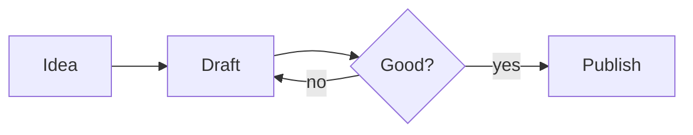

# Formatting

Everything you can write in a note, and how Jetfold shows it. Type any of it by hand, or use the [Format menu](writing.md#the-format-menu) and the [slash menu](writing.md#the-slash-menu).

## Headings

Start a line with one to six `#` characters and a space:

```markdown
# Heading 1
## Heading 2
### Heading 3
```

## Emphasis

| You type | You see |
|---|---|
| `**bold**` or `__bold__` | **bold** |
| `*italic*` or `_italic_` | *italic* |
| `***bold italic***` | ***bold italic*** |
| `~~strikethrough~~` | ~~strikethrough~~ |
| `==highlight==` | a highlight in the theme's highlight color |
| `` `inline code` `` | `inline code` in monospace |

## Lists

Start a line with `- ` for a bullet, or `1. ` for a numbered list. **Return** continues the list, and **Tab** and **⇧Tab** change the level.

**⌥↑** and **⌥↓** move a list item up or down, together with any sub-items.

## Tasks

Start a line with `- [ ] ` for a task, or `- [x] ` for a completed one. Click the checkbox, or press **⌘.**, to tick it off.

Tasks from every note show up in the [Tasks view](views-and-tags.md#tasks-and-agenda), and a task with an [@date](finding.md#dates-and-the-agenda) has a deadline.

## Quotes

Start a line with `> `.

```markdown
> The best way to have a good idea
> is to have lots of ideas.
```

## Callouts

A callout is a quote that starts with a type in square brackets, drawn as a tinted box with an icon:

```markdown
> [!warning] Mind the gap
> The platform is narrow here.
```


The main types are `note`, `tip`, `important`, `warning`, and `caution`. Callouts are plain Markdown, so other apps show them as ordinary quotes.

## Horizontal rules

A line containing just `---` becomes a horizontal divider.

## Links

`[text](https://example.com)` shows as a link reading "text". **⌘-click** a link to open it.

- **⌘K** turns the selected text into a link.
- **Paste a web address** and Jetfold links it under the page title.
- **Paste a URL over selected text** to link that text to it.

For links between notes, [wikilinks](links.md) are usually more convenient.

## Code

Wrap text in backticks for inline code: `` `npm install` ``. For a code block, put code between two lines of three backticks, with a language name for syntax highlighting:

````markdown
```python
def greet(name):
    return f"Hello, {name}!"
```
````


## Tables

Jetfold renders Markdown tables as a grid you edit in place:

```markdown
| Fruit  | Color  | Price |
|--------|--------|------:|
| Apple  | Red    | 1.20  |
| Banana | Yellow | 0.50  |
```

Click a cell and type, and **Tab** moves to the next one. Hover over a row or column edge for a grip: click it to sort, align, or delete, or drag it to move the row or column. The file keeps an ordinary Markdown table that reads well in any editor.


## Math

Write LaTeX math between dollar signs: `$E = mc^2$` for a formula in the line, or `$$` lines for a block:

```markdown
$$
\int_0^\infty e^{-x^2}\,dx = \frac{\sqrt{\pi}}{2}
$$
```

Click a formula to edit it, and watch the result change as you type. Ordinary dollar amounts like "$5 and $10" stay plain text.


## Diagrams

A code block in the `mermaid` language is drawn as a diagram: flowcharts, sequence diagrams, timelines, pie charts, and more, written as text.

````markdown

````


Click a diagram to edit it; it redraws as you type. See the [Mermaid documentation](https://mermaid.js.org/intro/) for every kind of diagram.

## Images

`` shows the image right in the note. The easiest way to add one is to drop or paste it; see [Images](images.md).

## Footnotes

Put `[^1]` where a footnote belongs, and write the footnote on a line starting `[^1]:`, usually at the end. Hover over a footnote number to read it.

```markdown
Plain text lasts[^1] and reads well everywhere.

[^1]: Text files from the 1970s still open today.
```

## Comments

`<!-- like this -->` stays in the file but is hidden in exports. Press **⌘/** to comment out the selection or the current line.

## Properties

A note can start with properties between two `---` lines, in YAML, as many Markdown tools write it. Jetfold shows them as a tidy panel at the top of the note.

```markdown
---
status: draft
tags: [work, q3]
due: 2026-10-20
---
```


## A formatting cheat sheet

```markdown
# Heading 1
## Heading 2

**bold**  *italic*  ~~strike~~  ==highlight==  `code`

- bullet
    - nested bullet
1. numbered
- [ ] task @2026-10-10
- [x] done task

> quote

> [!tip] Callout title
> callout text

[link](https://example.com)   [[Wikilink]]   #tag   

| A | B |
|---|---|
| 1 | 2 |

footnote[^1]

[^1]: the footnote

$inline math$

$$
display math
$$

---
```

Next: [Links and Wikilinks](links.md)
