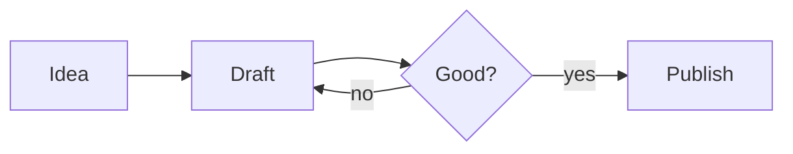

# Writing and Formatting

Jetfold's editor is a **live preview** Markdown editor. You write ordinary Markdown, and Jetfold shows it formatted as you go: headings are large, bold text is bold, links are links. The Markdown symbols (`**`, `#`, `[ ]( )` and so on) are hidden until your cursor moves into them, then they reappear, dimmed, so you can see and change exactly what you typed.


Your file always contains exactly the characters you typed. Jetfold never rewrites your Markdown, so it's safe to use alongside other editors, git, or any sync service.


## The Format menu

Everything below can be typed by hand, or applied from the **Format** menu or the [command palette](finding.md) (⌘P, then type "Format"). Every Format command is a **toggle**: run it again to remove the formatting.

| Command | Shortcut | Markdown |
|---|---|---|
| Headings → Heading 1–6 | | `# ` to `###### ` |
| Bold | ⌘B | `**text**` |
| Italic | ⌘I | `*text*` |
| Strikethrough | | `~~text~~` |
| Highlight | | `==text==` |
| Link | ⌘K | `[text](url)` |
| Link and Fill Title | ⌥⌘K | `[Page Title](url)` |
| Follow Link | ⌃Return | |
| Bullet List | ⇧⌘8 | `- ` |
| Ordered List | | `1. ` |
| Task List | | `- [ ] ` |
| Toggle Task | ⌘. | `- [ ]` ↔ `- [x]` |
| Quote | | `> ` |
| Comment | ⌘/ | `<!-- text -->` |
| Code | | `` `text` `` |
| Code Block | | ```` ``` ```` fences |
| Math | | `$x^2$` |
| Math Block | | `$$ … $$` |
| Footnote | | `[^1]` and `[^1]: …` |
| Table | | a new table; see [Tables](#tables) |
| Clear Formatting | ⌥⌘⌫ | removes inline markup |


With no text selected, inline commands such as Bold insert an empty pair of markers with the cursor between them, ready to type. Line commands such as Bullet List work on every line the selection touches.

## The slash menu

Type `/` at the start of a line, or after a space, to insert a block without remembering its Markdown. Keep typing to narrow the list (`/tab` finds Table), then press **Return** or **Tab**; **Escape** leaves the `/` as typed.


The menu has headings, lists, callouts, code and math blocks, diagrams, tables, dates, and your [templates](daily-notes-and-inbox.md#templates).

## Front matter (properties)

A note can start with a block of properties between two `---` lines, in YAML, as many Markdown tools write it:

```markdown
---
status: draft
tags: [work, q3]
aliases:
  - Q3 Plan
due: 2026-10-20
---
```

Jetfold shows it as a tidy panel at the top of the note. Click the panel, or move the cursor into it, to edit the YAML.


The properties are only displayed: `tags:` here aren't added to your `#tags`.

## Headings

Start a line with one to six `#` characters and a space:

```markdown
# Heading 1
## Heading 2
### Heading 3
```

The `#` marks are hidden unless the cursor is on the line.

### Folding sections

Hover over the editor and a small chevron appears to the left of each heading. Click it to **fold** the section: everything under the heading, up to the next heading of the same or higher level, collapses into a "•••" pill. Click the pill or the chevron to unfold it.


From the keyboard:

- **View → Toggle Fold** (⌘') folds or unfolds the section the cursor is in.
- **View → Fold All** and **View → Unfold All** do every section in the note.

Folding only changes the view; the text in the file is untouched. Folds reset when you reopen a note.

## Emphasis

| You type | You see |
|---|---|
| `**bold**` or `__bold__` | **bold** |
| `*italic*` or `_italic_` | *italic* |
| `***bold italic***` | ***bold italic*** |
| `~~strikethrough~~` | ~~strikethrough~~ |
| `==highlight==` | a highlight in the theme's highlight color |
| `` `inline code` `` | `inline code` in monospace with a soft background |

## Lists

### Bullet lists

Start a line with `- `, `* ` or `+ `. Jetfold shows a proper bullet (•) and uses different bullets for deeper levels (• ◦ ▪).

### Numbered lists

Start a line with `1. ` (or any number). Numbers are shown exactly as you typed them.

### Working with lists

- **Return** continues the list with a new bullet, the next number, or a new empty task (and continues quotes too). Press Return on an empty item to end the list.
- **Tab** indents the current list item one level; **⇧Tab** outdents it.
- **⌥↑ / ⌥↓** moves the item up or down, together with any sub-items.

## Task lists

Start a line with `- [ ] ` for a task, or `- [x] ` for a completed one. Jetfold draws a real checkbox.

- **Click the checkbox** to tick or untick it.
- **⌘.** (Format → Toggle Task) toggles the task on the cursor's line.
- Completed tasks are dimmed.
- In the command palette, **Complete Task** / **Uncomplete Task** is offered first whenever the cursor is on a task.

## Quotes

Start a line with `> `. Quotes get a bar down the left side; the `>` is hidden except on the line you're editing.

```markdown
> The best way to have a good idea
> is to have lots of ideas.
```

## Callouts

A callout is a quote that starts with a type in square brackets. It draws as a tinted box with an icon and a title:

```markdown
> [!warning] Mind the gap
> The platform is narrow here.
```

The text after the type is the title; leave it out and the type's name is used ("Warning").


The main types are `note`, `tip`, `important`, `warning`, and `caution`, in the accent color, green, purple, amber, and red. Common aliases like `info` or `danger` work too.

Any other type draws as a note, so a typo still makes a box. Callouts are plain Markdown, so other apps show them as ordinary quotes.

## Horizontal rules

A line containing just `---` becomes a horizontal divider.

## Links

`[text](https://example.com)` shows as a link reading "text". The brackets and URL are hidden until your cursor is inside the link.

- **⌘-click** a link, or press **⌃Return** with the cursor in it (Format → Follow Link), to open it.
- **⌘K** turns the selected text into a link, or removes the link under the cursor.
- **Paste a web address** and Jetfold links it under the page title. Use **⌥⇧⌘V** to paste just the address.
- **Paste a URL over selected text** to link that text to it.
- **⌥⌘K** (Link and Fill Title) does the same for a URL you've selected or copied.

Web links open in your browser. Links to other `.md` or `.txt` files (for example `[Plan](projects/plan.md)`) open that note in Jetfold.

For links between notes, [wikilinks](links.md) are usually more convenient.

## Code

### Inline code

Wrap text in backticks: `` `npm install` ``. It's shown in the monospace font with a light background.

### Code blocks

Put code between two lines of three backticks. Add a language name after the opening backticks for syntax highlighting:

````markdown
```python
def greet(name):
    return f"Hello, {name}!"
```
````

When the cursor is outside the block, the fences are hidden and the language is shown as a small label. Highlighting covers dozens of languages, from JavaScript and Python to SQL and shell. The colors follow your [theme](settings.md#appearance-and-theme).


## Tables

Jetfold renders GitHub-style tables as real tables:

```markdown
| Fruit  | Color  | Price |
|--------|--------|------:|
| Apple  | Red    | 1.20  |
| Banana | Yellow | 0.50  |
```

Tables show as a grid you edit in place. Click a cell and type; formatting works inside cells too. The file keeps an ordinary Markdown table that reads well in any editor.

### Editing tables

| Key or action | What it does |
|---|---|
| Tab / ⇧Tab | Next / previous cell |
| Arrow keys | Move between cells |
| Return | The cell below |
| ⇧Return | A line break inside the cell |
| Drag across cells, or ⇧-arrows | Select several cells |
| Backspace or Delete on a selection | Clear the cells |
| ⌘Z / ⇧⌘Z | Undo and redo, for the whole note |

**Rows and columns:** hover over a row's or column's edge for its grip.

- **Click** the grip for a menu: sort, align left, center or right, clear, or delete.
- **Drag** the grip to move the row or column.
- **Click** the border between two rows or columns to insert one there. At the table's edge, the **+** buttons add a row or column.

**Format → Table** (or `/table` in the [slash menu](#the-slash-menu)) starts a new table.


## Math

Jetfold renders LaTeX math with KaTeX.

- **Inline math:** `$E = mc^2$` shows as a formula in the line.
- **Display math:** put the formula between `$$` lines:

```markdown
$$
\int_0^\infty e^{-x^2}\,dx = \frac{\sqrt{\pi}}{2}
$$
```

Click a formula to edit its TeX. While you edit a display block, the rendered result stays visible underneath, so you can watch it change as you type.

Ordinary dollar amounts aren't mistaken for math: "It costs $5 and $10" stays plain text. To type a literal dollar sign right before other text, write `\$`.


## Diagrams

A code block in the `mermaid` language is drawn as a diagram: flowcharts, sequence diagrams, timelines, pie charts, Gantt charts, and more, written as text.

````markdown

````


- **Click a diagram** to edit its code. While you edit, the diagram stays visible underneath and redraws as you type; a mistake shows what's wrong instead.
- Diagrams match your theme.
- **/Diagram** in the [slash menu](#the-slash-menu) starts one with a small example.


See the [Mermaid documentation](https://mermaid.js.org/intro/) for every kind of diagram and its syntax.

## Calculator

Type a sum followed by `=` and Jetfold offers the answer. Press **Return** to insert it, or keep typing to ignore it.

```markdown
254,652+10348=265,000
```

- Use `+ - * / ^ %` and parentheses. Thousands commas work too.
- **Variables:** a line like `x=265,000` defines one, and later lines can use it: `x+43534=` offers `308,534`.

## Images

`` shows the image right in the note. When the cursor is on the image's line, the Markdown appears above the picture so you can edit it. The easiest way to add an image is to drop or paste it; see [Images](images.md).

## Footnotes

Put `[^1]` where a footnote belongs, and write the note itself on a line of its own starting `[^1]:`, usually at the end:

```markdown
Plain text lasts[^1] and reads well everywhere[^why].

[^1]: Text files from the 1970s still open today.
[^why]: Even when the app that made them is gone.
```

- References show as small raised numbers. **Hover** over one to read the footnote, or click to jump to it.
- **Format → Footnote** adds the next number at the cursor and starts the footnote at the end.

## Comments

`<!-- like this -->` is an HTML comment: it stays in the file but is invisible in exported HTML and PDF. Press **⌘/** to comment out the selection or the current line, and again to remove the comment.

## Pasting from other apps

Text copied with formatting, from a web page, an email, or a word processor, pastes as Markdown, with its formatting, lists, tables, and code intact. Pictures from the web come in as image links; other pictures in the copy are left out.

Plain text pastes exactly as copied.

To paste just the words, with no formatting, use **⌥⇧⌘V** (Edit → Paste and Match Style).

## Clear Formatting

**⌥⌘⌫** removes bold, italic, strikethrough, highlight, code, math, and links from the selected text (or the current line if nothing is selected), leaving just the words. Headings, lists, and quotes are kept.

## The Selection menu

The **Selection** menu grows, shrinks, and multiplies your selection.


### Expand and shrink

**Expand Selection** (⌃⇧⌘→) selects the next bigger piece of text around the cursor: the word, then the sentence, the paragraph, the section, and finally the whole note.

**Shrink Selection** (⌃⇧⌘←) steps back down the same way. **Expand Selection to Line** (⌘L) selects the whole line, and pressing it again adds the next line.

### Multiple cursors

Jetfold can edit in several places at once.

| Action | How |
|---|---|
| Add a cursor | ⌘-click |
| Add a cursor on the line above / below | ⌥⌘↑ / ⌥⌘↓ (Add Selection Up / Down) |
| Select the next occurrence of the selection | ⌘D (Add Occurrence) |
| Select every occurrence | ⇧⌘L (Add Each Occurrence) |
| Drop the last occurrence you added | ⌘U (Remove Occurrence) |
| One cursor for every selected line | Split Selection into Lines |
| Rectangular (column) selection | ⌥-drag |
| Back to one cursor | Escape |

Typing, deleting, and formatting will apply to every cursor.

## Find and replace

Press **⌘F** to open the find bar at the top of the note. It stays visible as you scroll.


- **Aa** matches case, **W** matches whole words only, **.\*** uses regular expressions.
- **Return** / **⇧Return** go to the next or previous match. **⌥Return** selects every match as multiple cursors.
- Click **›** (or press **⌥⌘F**) to show the Replace row. **Return** in the Replace field replaces the current match and moves on; **⌘Return** replaces all.
- **Escape** closes the bar.

| Command (Edit → Find) | Shortcut |
|---|---|
| Find… | ⌘F |
| Find and Replace… | ⌥⌘F |
| Find Next | ⌘G |
| Find Previous | ⇧⌘G |
| Use Selection for Find | ⌘E |

To search across *all* notes, use **Search in Notes** (⇧⌘F); see [Finding Things](finding.md).

## Tabs and indentation

**Tab** inserts four spaces, or indents every selected line. **⇧Tab** outdents. On list items, Tab and ⇧Tab move the item a level (see [Lists](#lists)).

## Spelling

Misspelled words get the usual red underline. Right-click one for suggestions, or turn checking off in **Edit → Spelling and Grammar**. Nothing is ever corrected automatically.

Code, links, tags, and dates aren't checked.

## Focus mode

**View → Focus Mode** (⇧⌘J) helps you concentrate on what you're writing:

- Everything except the paragraph you're in fades back.
- The line you're on stays in the middle of the window, like paper in a typewriter.

It pairs well with **View → Editor** (⌘1), which hides the other columns.

## Undo

**⌘Z** and **⇧⌘Z** undo and redo in the current note. Notes keep separate undo histories, which survive saves.

## A formatting cheat sheet

```markdown
# Heading 1
## Heading 2

**bold**  *italic*  ~~strike~~  ==highlight==  `code`

- bullet
    - nested bullet
1. numbered
- [ ] task @2026-10-10
- [x] done task

> quote

> [!tip] Callout title
> callout text

[link](https://example.com)   [[Wikilink]]   #tag   

| A | B |
|---|---|
| 1 | 2 |

footnote[^1]

[^1]: the footnote

$inline math$

$$
display math
$$

---
```

Next: [Links and Wikilinks](links.md)
