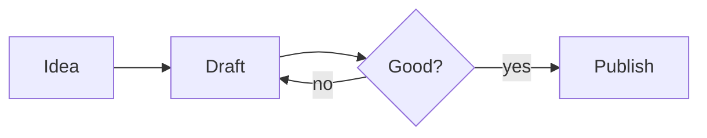

# Writing and Formatting

Jetfold's editor is a **live preview** Markdown editor. You write ordinary Markdown, and Jetfold shows it formatted as you go: headings are large, bold text is bold, links are links. The Markdown symbols (`**`, `#`, `[ ]( )` and so on) are hidden until your cursor moves into them, then they reappear, dimmed, so you can see and change exactly what you typed.


Your file always contains exactly the characters you typed. Jetfold never rewrites your Markdown, so it's safe to use alongside other editors, git, or any sync service.

Prose uses the system font (16 point by default), and code uses its monospaced version (14 point). You can change both in [Settings](settings.md#editor).

## How formatting is revealed

- When your cursor is **outside** a piece of formatting, you see the result: **bold**, *italic*, a link's text, a rendered formula.
- When your cursor is **inside** it (or right after it), its markers appear dimmed so you can edit them. Only that span is revealed; the rest of the line stays formatted.
- Block-level markup (headings, quotes, code fences) is revealed when the cursor is on that line or inside that block.

## The Format menu

Everything below can be typed by hand, or applied from the **Format** menu or the [command palette](finding.md) (⌘P, then type "Format"). Every Format command is a **toggle**: run it again to remove the formatting. Each one is a single undo step and leaves your cursor where it was.

| Command | Shortcut | Markdown |
|---|---|---|
| Headings → Heading 1–6 | | `# ` to `###### ` |
| Bold | ⌘B | `**text**` |
| Italic | ⌘I | `*text*` |
| Strikethrough | | `~~text~~` |
| Highlight | | `==text==` |
| Link | ⌘K | `[text](url)` |
| Link and Fill Title | ⌥⌘K | `[Page Title](url)` |
| Follow Link | ⌃Return | |
| Bullet List | ⇧⌘8 | `- ` |
| Ordered List | | `1. ` |
| Task List | | `- [ ] ` |
| Toggle Task | ⌘. | `- [ ]` ↔ `- [x]` |
| Quote | | `> ` |
| Comment | ⌘/ | `<!-- text -->` |
| Code | | `` `text` `` |
| Code Block | | ```` ``` ```` fences |
| Math | | `$x^2$` |
| Math Block | | `$$ … $$` |
| Footnote | | `[^1]` and `[^1]: …` |
| Table | | a new table; see [Tables](#tables) |
| Clear Formatting | ⌥⌘⌫ | removes inline markup |


With no text selected, inline commands such as Bold insert an empty pair of markers with the cursor between them, ready to type. Line commands such as Bullet List work on every line the selection touches.

## The slash menu

Type `/` at the start of a line, or after a space, to insert a block without remembering its Markdown. Keep typing to narrow the list (`/tab` finds Table), then press **Return** or **Tab**; **Escape** leaves the `/` as typed.


| Group | Items |
|---|---|
| Text | Heading 1–3, Quote |
| Lists | Bullet List, Numbered List, Task |
| Callouts | Note, Tip, Important, Warning and Caution [callouts](#callouts) |
| Blocks | Code Block (the cursor waits for the language), Math Block, Diagram, Table, Divider, Comment |
| Insert | Link to Note (opens the note list), Today's Date, Tomorrow's Date |
| Templates | Your [templates](daily-notes-and-inbox.md#templates), by name: inserts the template's text, filled in, with the cursor at its `{{cursor}}` |

In the middle of a line, a block (a heading, a list, a callout, code) starts on a new line, while a date or a link goes right where you typed. A `/` straight after other characters, as in `and/or` or a path, is just a slash, and the menu doesn't open inside code or math.

## Front matter (properties)

A note can start with a block of properties between two `---` lines, in YAML, as many Markdown tools write it:

```markdown
---
status: draft
tags: [work, q3]
aliases:
  - Q3 Plan
due: 2026-10-20
---
```

Jetfold draws it as a tidy panel at the top of the note: each property on its own row, lists as chips, `tags` as tag chips and dates as date chips. Click the panel, or move the cursor into it, to edit the YAML itself.


Front matter is left out of the note list's previews and of plain-text exports. Jetfold reads the common forms (`key: value`, `key: [a, b]`, and `key:` followed by `- item` lines) and shows anything else as written. The properties are only displayed: `tags:` here aren't added to your `#tags`, and `aliases:` aren't used for links.

## Headings

Start a line with one to six `#` characters and a space:

```markdown
# Heading 1
## Heading 2
### Heading 3
```

The `#` marks are hidden unless the cursor is on the line.

### Folding sections

Hover over the editor and a small chevron appears to the left of each heading. Click it to **fold** the section: everything under the heading, up to the next heading of the same or higher level, collapses into a "•••" pill. Click the pill or the chevron to unfold it.


From the keyboard:

- **View → Toggle Fold** (⌘') folds or unfolds the section the cursor is in.
- **View → Fold All** and **View → Unfold All** do every section in the note.

Folding only changes the view; the text in the file is untouched. Folds reset when you reopen a note.

## Emphasis

| You type | You see |
|---|---|
| `**bold**` or `__bold__` | **bold** |
| `*italic*` or `_italic_` | *italic* |
| `***bold italic***` | ***bold italic*** |
| `~~strikethrough~~` | ~~strikethrough~~ |
| `==highlight==` | a highlight in the theme's highlight color |
| `` `inline code` `` | `inline code` in monospace with a soft background |

## Lists

### Bullet lists

Start a line with `- `, `* ` or `+ `. Jetfold shows a proper bullet (•) and uses different bullets for deeper levels (• ◦ ▪).

### Numbered lists

Start a line with `1. ` (or any number). Numbers are shown exactly as you typed them.

### Working with lists

- **Return** continues the list with a new bullet, the next number, or a new empty task (and continues quotes too). Press Return on an empty item to end the list.
- **Tab** indents the current list item one level; **⇧Tab** outdents it. Numbered items are renumbered to fit their new level: an item that starts a new sublist becomes `1.`, and one that joins an existing level continues its numbering.
- With several lines selected (or several cursors), Tab and ⇧Tab move every item at once.
- **⌥↑ / ⌥↓** moves the item up or down, taking its sub-items with it, past the whole item next to it. Numbered items swap numbers so the list still counts up. The same keys move a callout whole from its `> [!type]` line, and a folded section with everything hidden under it. Select several lines to move just those lines.

## Task lists

Start a line with `- [ ] ` for a task, or `- [x] ` for a completed one. Jetfold draws a real checkbox.

- **Click the checkbox** to tick or untick it.
- **⌘.** (Format → Toggle Task) toggles the task on the cursor's line.
- Completed tasks are dimmed.
- In the command palette, **Complete Task** / **Uncomplete Task** is offered first whenever the cursor is on a task.

## Quotes

Start a line with `> `. Quotes get a bar down the left side; the `>` is hidden except on the line you're editing.

```markdown
> The best way to have a good idea
> is to have lots of ideas.
```

## Callouts

A callout is a quote that starts with a type in square brackets. It draws as a tinted box with an icon and a title:

```markdown
> [!warning] Mind the gap
> The platform is narrow here.
```

The text after the type is the title; leave it out and the type's name is used ("Warning"). The type is shown as an icon until the cursor is on that line.


| Type | Color |
|---|---|
| `note`, `info`, `todo`, `abstract`, `summary` | the theme's accent |
| `tip`, `hint`, `success`, `check`, `done` | green |
| `important`, `example` | purple |
| `warning`, `attention`, `question`, `help`, `faq` | amber |
| `caution`, `danger`, `error`, `bug`, `failure` | red |
| `quote`, `cite` | grey |

Any other type draws as a note, so a typo still makes a box. Callouts are plain Markdown: in any other app they read as an ordinary quote. They keep their box in HTML, PDF and EPUB exports, and read as "Warning: Mind the gap" in plain text.

## Horizontal rules

A line containing just `---` becomes a horizontal divider.

## Links

`[text](https://example.com)` shows as a link reading "text". The brackets and URL are hidden until your cursor is inside the link.

- **⌘-click** a link, or press **⌃Return** with the cursor in it (Format → Follow Link), to open it.
- **⌘K** turns the selected text into a link and puts the cursor where the URL goes. With a URL selected, the cursor goes where the text goes instead. Inside an existing link, ⌘K removes the link and keeps its text.
- **Paste a web address** and Jetfold links it under the page's title, as ⌥⌘K does below. The address goes in straight away and the title replaces it when the page answers; if the page has no title, you keep the plain address. Use **⌥⇧⌘V** to paste just the address, or turn this off in Settings → Editor → **Fill in link titles when pasting a URL**.
- **Paste a URL over selected text** to link that text to it.
- **⌥⌘K** (Link and Fill Title) fetches the web page and uses its title as the link text. Select a URL in your note, or copy one and place the cursor, then press ⌥⌘K. The URL appears straight away and is replaced by the page title as soon as it arrives.

Web links open in your browser. Links to other `.md` or `.txt` files (for example `[Plan](projects/plan.md)`) open that note in Jetfold.

For links between notes, [wikilinks](links.md) are usually more convenient.

## Code

### Inline code

Wrap text in backticks: `` `npm install` ``. It's shown in the monospace font with a light background.

### Code blocks

Put code between two lines of three backticks. Add a language name after the opening backticks for syntax highlighting:

````markdown
```python
def greet(name):
    return f"Hello, {name}!"
```
````

When the cursor is outside the block, the fences are hidden and the language is shown as a small label. Highlighting is available for dozens of languages, including JavaScript, TypeScript, Python, Go, Rust, Swift, SQL, HTML, CSS, JSON, YAML and shell. The colors follow your [theme](settings.md#appearance-and-theme).


## Tables

Jetfold renders GitHub-style tables as real tables:

```markdown
| Fruit  | Color  | Price |
|--------|--------|------:|
| Apple  | Red    | 1.20  |
| Banana | Yellow | 0.50  |
```

Tables show as a grid you edit in place. Click a cell and type; Markdown inside cells (bold, links, wikilinks, tags, dates, highlights, math) is highlighted as you write it. The Markdown in the file stays an ordinary table, with its columns lined up so it reads well in any editor.

### Editing tables

| Key or action | What it does |
|---|---|
| Tab / ⇧Tab | Next / previous cell |
| Arrow keys | Move between cells at the edge of a cell's text |
| Return | The cell below |
| ⇧Return | A line break inside the cell |
| Drag across cells, or ⇧-arrows | Select several cells, to copy, cut, paste or clear them |
| Backspace or Delete on a selection | Clear the cells (empty rows and columns go) |
| ⌘Z / ⇧⌘Z | Undo and redo, for the whole note |

**Rows and columns:** hover over a row's or column's edge for its grip.

- **Click** the grip for a menu: sort, align left, center or right, clear, or delete.
- **Drag** the grip to move the row or column.
- **Click** the border between two rows or columns to insert one there. At the table's edge, the **+** buttons add a row or column, and dragging them adds several.

**Format → Table** (or `/table` in the [slash menu](#the-slash-menu)) starts a new table.

A table only lines its columns up when you first see it; that change is saved along with your next edit to the note, never on its own, so just opening a note doesn't change its file.


## Math

Jetfold renders LaTeX math with KaTeX.

- **Inline math:** `$E = mc^2$` shows as a formula in the line.
- **Display math:** put the formula between `$$` lines:

```markdown
$$
\int_0^\infty e^{-x^2}\,dx = \frac{\sqrt{\pi}}{2}
$$
```

Click a formula to edit its TeX. While you edit a display block, the rendered result stays visible underneath, so you can watch it change as you type.

Ordinary dollar amounts aren't mistaken for math: "It costs $5 and $10" stays plain text. To type a literal dollar sign right before other text, write `\$`.


## Diagrams

A code block in the `mermaid` language is drawn as a diagram: flowcharts, sequence diagrams, timelines, pie charts, Gantt charts and more, written as text.

````markdown

````


- **Click a diagram** to edit its code. While you edit, the diagram stays visible underneath and redraws as you type; a mistake shows what's wrong instead.
- Diagrams take your theme's colors and the editor's font, and follow light and dark.
- **/Diagram** in the [slash menu](#the-slash-menu) starts one with a small example.
- Exports to HTML, PDF and EPUB include the drawn diagram; plain text keeps the code.
- The file keeps exactly what you wrote, so the diagram is plain text other Markdown apps (and many code hosts) can draw too.

See the [Mermaid documentation](https://mermaid.js.org/intro/) for every kind of diagram and its syntax.

## Calculator

Type a sum followed by `=` and Jetfold offers the answer. Press **Return** to insert it, or keep typing to ignore it.

```markdown
254,652+10348=265,000
```

- Operators: `+ - * / x × ÷ ^ %` and parentheses, with the usual precedence. Numbers can have thousands commas and decimals.
- If you typed commas, the answer has them too.
- **Variables:** a line like `x=265,000` or `rate = 0.5` defines one. Later lines can use it: `x+43534=` offers `308,534`. Definitions can build on earlier ones (`y = x * 2`), a later definition of the same name wins, and only lines above the cursor count. A list marker before the name is fine.
- `x` between two values still means multiply.
- A lone number or name (`5=`, `x=`) offers nothing, which is how a definition starts. Nothing is offered inside code, math or links.


## Images

`` shows the image right in the note. When the cursor is on the image's line, the Markdown appears above the picture so you can edit it. The easiest way to add an image is to drop or paste it; see [Images](images.md).

## Footnotes

Put `[^1]` where a footnote belongs, and write the note itself on a line of its own starting `[^1]:`, usually at the end:

```markdown
Plain text lasts[^1] and reads well everywhere[^why].

[^1]: Text files from the 1970s still open today.
[^why]: Even when the app that made them is gone.
```

- References show as small raised numbers, numbered in the order they first appear, whatever their labels. Labels can be numbers or words (`[^why]`).
- Definitions show in smaller type, with their number in front. A definition runs on to the next blank line or the next definition.
- **Hover** over a reference to read its note. **Click** a reference to jump to its note, and click the number in front of a note to jump back.
- **Format → Footnote** adds the next number at the cursor and starts its note at the end, with the cursor there.
- In HTML, PDF and EPUB exports, footnotes are numbered links with the notes listed at the end; in plain text they read `[1]`.


## Comments

`<!-- like this -->` is an HTML comment: it stays in the file but is invisible in exported HTML and PDF. Press **⌘/** to comment out the selection or the current line, and again to remove the comment.

## Pasting from other apps

Text copied with formatting, from a web page, an email or a word processor, pastes as Markdown: bold, italic, strikethrough, headings, links, lists, task lists, quotes, code blocks and tables come along, written the way you'd type them (`-` bullets, tables with their columns lined up). Pictures from the web come in as image links; other pictures in the copy are left out.

Text without formatting pastes exactly as copied, and so does anything copied from a code editor, or pasted into a code block or math.

To paste just the words, with no formatting, use **⌥⇧⌘V** (Edit → Paste and Match Style).

## Clear Formatting

**⌥⌘⌫** removes bold, italic, strikethrough, highlight, code, math and links from the selected text (or the current line if nothing is selected), leaving just the words. Headings, lists and quotes are kept.

## The Selection menu

The **Selection** menu grows, shrinks and multiplies your selection.


### Expand and shrink

**Expand Selection** (⌃⇧⌘→) selects the next bigger piece of text around the cursor, one step at a time:

1. the word
2. the formatted span it's in (bold text, a link, inline code)
3. the sentence
4. the paragraph, or the block (a list item, a quote, a code block, a table)
5. the whole list
6. the section under the nearest heading, heading included, then each bigger section around it
7. the whole note

**Shrink Selection** (⌃⇧⌘←) steps back down the same way. **Expand Selection to Line** (⌘L) selects the whole line, and pressing it again adds the next line.

### Multiple cursors

Jetfold can edit in several places at once.

| Action | How |
|---|---|
| Add a cursor | ⌘-click (on a link, ⌘-click follows the link instead) |
| Add a cursor on the line above / below | ⌥⌘↑ / ⌥⌘↓ (Add Selection Up / Down) |
| Select the next occurrence of the selection | ⌘D (Add Occurrence) |
| Select every occurrence | ⇧⌘L (Add Each Occurrence) |
| Drop the last occurrence you added | ⌘U (Remove Occurrence) |
| One cursor for every selected line | Split Selection into Lines |
| Rectangular (column) selection | ⌥-drag |
| Back to one cursor | Escape |

Typing, deleting, Bold, Italic, list and heading commands, and Tab in lists all work at every cursor.

## Find and replace

Press **⌘F** to open the find bar at the top of the note. It stays visible as you scroll.


- The bar shows how many matches there are ("5 found"), or which one is selected ("3 of 12").
- **Aa** matches case, **W** matches whole words only, **.\*** uses regular expressions.
- **Return** / **⇧Return** go to the next or previous match. **⌥Return** selects every match as multiple cursors.
- Click **›** (or press **⌥⌘F**) to show the Replace row. **Return** in the Replace field replaces the current match and moves on; **⌘Return** replaces all.
- **Escape** closes the bar.

| Command (Edit → Find) | Shortcut |
|---|---|
| Find… | ⌘F |
| Find and Replace… | ⌥⌘F |
| Find Next | ⌘G |
| Find Previous | ⇧⌘G |
| Use Selection for Find | ⌘E |

To search across *all* notes, use **Search in Notes** (⇧⌘F); see [Finding Things](finding.md).

## Tabs and indentation

**Tab** inserts four spaces, or indents every selected line. **⇧Tab** outdents. On list items, Tab and ⇧Tab move the item a level (see [Lists](#lists)).

## Spelling

Misspelled words get the usual red underline. Right-click one for suggestions, **Learn Spelling** and the rest of the standard macOS spelling menu; **Edit → Spelling and Grammar** has the rest, including turning checking off. Nothing is ever corrected automatically.

Code, web addresses, wikilinks, `#tags`, `@dates`, math and tables aren't checked, so names and code don't fill your notes with red.

## Focus mode

**View → Focus Mode** (⇧⌘J) helps you concentrate on what you're writing:

- Everything except the paragraph you're in (or the heading, list item, code block or table) fades back. Move on and the focus moves with you.
- As you type or move with the keyboard, the line you're on stays in the middle of the window, like paper in a typewriter. Clicking somewhere doesn't scroll, so the text stays under the pointer.
- The fading only shows while you're typing in the note; click elsewhere and the whole note is back.


It pairs well with **View → Editor** (⌘1), which hides the other columns. Focus mode is remembered with the workspace and applies to note windows too.

## Undo

**⌘Z** and **⇧⌘Z** undo and redo in the current note. Each note has its own undo history, and it survives saves and changes coming in from other windows.

## A formatting cheat sheet

```markdown
# Heading 1
## Heading 2

**bold**  *italic*  ~~strike~~  ==highlight==  `code`

- bullet
    - nested bullet
1. numbered
- [ ] task @2026-10-10
- [x] done task

> quote

> [!tip] Callout title
> callout text

[link](https://example.com)   [[Wikilink]]   #tag   

| A | B |
|---|---|
| 1 | 2 |

footnote[^1]

[^1]: the footnote

$inline math$

$$
display math
$$

---
```

Next: [Links and Wikilinks](links.md)
